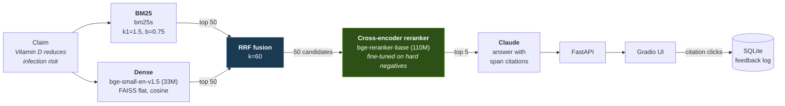

# ResearchOS

A scientific-literature research assistant whose retrieval quality comes from a
**cross-encoder reranker fine-tuned here**, not from an off-the-shelf model.

The RAG app is the harness. The reranker is the point. The deliverable is the
ablation table below: the same model, the same hyperparameters, the same seed,
trained twice on datasets that differ **only** in how their negatives were chosen.

---

## Demo

<!-- Record a 60s capture of the Gradio UI and drop it here as docs/demo.gif -->


> **Not yet recorded.** Start the app (below), run one of the example claims, expand a
> passage, and click "Mark as useful" — that is the full loop the GIF should show.

---

## Architecture



**Why two retrievers.** BM25 matches words; dense retrieval matches meaning. SciFact
punishes word-matching badly — its very first test claim, *"0-dimensional biomaterials
show inductive properties,"* is answered by an abstract about *"quantum dots for stem
cell labeling"* that shares **zero content words** with the claim. RRF merges the two
ranked lists without requiring their scores to be comparable.

**Why a separate reranker.** Scoring all 5,183 documents with a cross-encoder is
impossible at interactive latency. Retrieval gets recall up cheaply (94.2% of gold
passages land in the top 50); the reranker then reads all 50 carefully and reorders.

---

## Results

SciFact **test** split, 300 queries, 5,183 documents. Metrics from the official BEIR
evaluator. `results/metrics.json` is the source of truth; this table is rendered from
it by `scripts/render_readme.py`.

<!-- RESULTS:START -->

| Setup | nDCG@10 | Recall@50 | p95 latency | Params |
|---|---|---|---|---|
| BM25 only | 0.6863 | 0.8852 | 1 ms | — |
| BM25 + dense (RRF) | 0.7236 | 0.9420 | 38 ms | 33M |
| + off-the-shelf reranker | 0.7124 | 0.9420 | 250 ms | 110M |
| + fine-tuned, random negatives | — | — | — | — |
| + fine-tuned, hard negatives | — | — | — | — |
| Fine-tuned, ONNX INT8 | — | — | — | — |

<!-- RESULTS:END -->

Latency is end-to-end per query (retrieval + fusion + reranking), measured
single-query on an RTX 4060 Laptop, 8GB.

---

## Engineering decisions

### Hard-negative mining

A reranker's job is discriminating between passages that *all* look plausible — that is
what it is handed at inference time, since the retriever already filtered out the
obviously irrelevant. Training it on random negatives teaches the wrong task: telling
biomedical text from unrelated biomedical text is trivially easy, the loss collapses
early, and the model never learns the fine distinctions it will actually face.

So negatives are mined from the retriever's own output:

```
for each training query:
    retrieve top-50 with the same BM25 + dense + RRF pipeline used at inference
    drop every gold passage
    sample 7 negatives from ranks 10-50
```

Ranks 10–50, not 1–50, deliberately. The very top of the list is where unlabeled
positives hide — SciFact's judgments are sparse, and a passage ranked 3rd for a claim
is quite likely relevant even if no annotator marked it. Training on those as negatives
teaches the model to suppress correct answers. Starting at rank 10 trades a little
hardness for a lot of label safety.

The control arm draws its negatives uniformly from the corpus. Both datasets have the
same size, the same positives, in the same order, with the same number of negatives per
group. `configs/train_random.yaml` and `configs/train_hard.yaml` differ only in the
negatives file, the output directory, and the run name — verifiable with `diff`.

How different the two datasets actually are, measured on the 919 mined groups:

| | hard | random |
|---|---|---|
| Groups | 919 | 919 |
| Negatives per group | 7 | 7 |
| Positives | identical | identical |
| Negatives that the retriever surfaced in the top-50 **for their own query** | 100.0% | 0.9% |
| Negative instances shared between the two files | 6 / 6,433 | |

That 100% vs 0.9% is the intervention, stated numerically. A hard negative is a passage
the retrieval stack genuinely confused for an answer to *this* claim; a random negative
almost never is.

### Listwise loss, not pointwise

The objective is `MultipleNegativesRankingLoss` over a group of 1 positive and 7
negatives — softmax cross-entropy across the group. Pointwise BCE would ask "is this
pair relevant, yes or no," which is not the question at inference time. Listwise asks
"which of these eight is the right one," which is exactly the question.

### Fitting 110M params into 8GB

Full fine-tuning at batch size 8 OOMs immediately, because
`MultipleNegativesRankingLoss` expands each batch item into 8 pairs — 64 sequences of
384 tokens per forward pass. The escape ladder in `src/rerank/train.py`, in order:

1. **Gradient checkpointing.** Recompute activations during the backward pass instead
   of storing them. Costs ~30% throughput, saves most of the activation memory.
2. **LoRA (r=16).** Freeze the backbone, train low-rank adapters on the attention
   projections. Drops optimizer state from ~1.3GB to a few MB.

Sequence length, batch size, and dataset size are never reduced — they are pinned by
the experiment design, and shrinking them would make the ablation incomparable.
`torch.cuda.max_memory_allocated()` is printed after every run so headroom stays visible.

### The quantization tradeoff

Row 6 exports the row-5 model to ONNX and applies INT8 dynamic quantization: weights
stored as int8, activation scales chosen at runtime, no calibration set needed. The
file shrinks roughly 4x and CPU inference speeds up substantially.

It is not free. Quantization is lossy, so row 6 **re-evaluates quality** rather than
reporting speed alone. Reporting a latency win without the accuracy column next to it
would be dishonest — the whole question is whether the speedup costs more than it is
worth, and that is only answerable with both numbers side by side.

### Prompt injection

Retrieved passages are untrusted input. In `src/api/generate.py` they are never
concatenated into the instruction block — instructions are fixed in the system prompt
before any passage is seen, and passages arrive in the user turn wrapped in
`<passage id="...">` tags with tag-like sequences stripped so a passage cannot close its
own wrapper. The API call passes **no tools at all**, so retrieved text has no
tool-calling path to reach.

---

## Reproducing

Stages are sequential. Each writes its metric to `results/` before the next begins.

```bash
python scripts/run_baseline.py       --config configs/baseline.yaml          # rows 1, 2
python scripts/run_rerank.py         --config configs/rerank_offshelf.yaml   # row 3
python scripts/mine_negatives.py     --config configs/mine_negatives.yaml
python scripts/train.py              --config configs/train_random.yaml
python scripts/run_rerank.py         --config configs/rerank_random_ft.yaml  # row 4
python scripts/train.py              --config configs/train_hard.yaml
python scripts/run_rerank.py         --config configs/rerank_hard_ft.yaml    # row 5
python scripts/export_onnx.py        --config configs/onnx.yaml
python scripts/benchmark_latency.py  --config configs/onnx.yaml
python scripts/run_rerank.py         --config configs/rerank_onnx_int8.yaml  # row 6
python scripts/render_readme.py
```

Every script takes a config file. No hyperparameter is hardcoded.

### Setup

```bash
uv venv --python 3.11
.venv\Scripts\activate.bat
uv pip install -r requirements.txt
```

Set `ANTHROPIC_API_KEY` in your environment (or a `.env` file) for answer generation.
Without it, retrieval and reranking still work and the UI shows ranked passages only.
`WANDB_API_KEY` is optional; training logs to Weights & Biases when it is present and
runs normally when it is not.

### Running the app

```bash
python scripts/serve_api.py --config configs/app.yaml
```

```bash
python scripts/serve_ui.py --config configs/app.yaml
```

API docs at `http://127.0.0.1:8000/docs`, UI at `http://127.0.0.1:7860`.

---

## Hardware

Everything here runs on one laptop: **RTX 4060, 8GB VRAM**. No cloud GPU was used, and
none is required. Training a full arm of the ablation takes roughly 20 minutes.

---

## Repository layout

```
src/
  config.py    config loading, seeding, VRAM reporting
  data/        loading, negative mining
  retrieval/   bm25, dense, rrf fusion
  rerank/      training, evaluation, onnx export and runtime
  api/         fastapi app, pipeline, claude generation, sqlite log
  ui/          gradio app
configs/       one yaml per experiment
results/       metrics.json, latency.json, feedback.db
scripts/       entrypoints
```

---

## Limitations and next steps

Bounding the claims honestly is a feature of this project, not an apology.

- **Evaluation uses a public benchmark, not a bespoke labeled set.** SciFact is a
  standard BEIR dataset. That makes the numbers comparable to published work, but it
  also means the model has been tuned against a benchmark that many models have seen.
  Nothing here demonstrates performance on a proprietary corpus.
- **Citation-click feedback is logged but the retraining loop is designed, not
  running.** Every click lands in `results/feedback.db` with its query and the
  passages that were shown. Turning that into a training signal — deduplication,
  position-bias correction, a periodic mining job — is specified and not built.
- **Distillation to a ~30M student and Triton serving are planned, not done.** The
  current serving path is a single-process FastAPI app with the 110M reranker. That is
  adequate for a demo and would not survive real traffic.
- **The SciFact test split is small.** 300 queries means differences of a point or two
  in nDCG@10 sit near the noise floor. The ablation's direction is the claim; its exact
  magnitude carries a wide error bar, and no significance test has been run.
- **Generation is not evaluated.** Retrieval is the measured bottleneck and the only
  thing this project makes claims about. Answer quality, faithfulness, and citation
  correctness are unmeasured.
